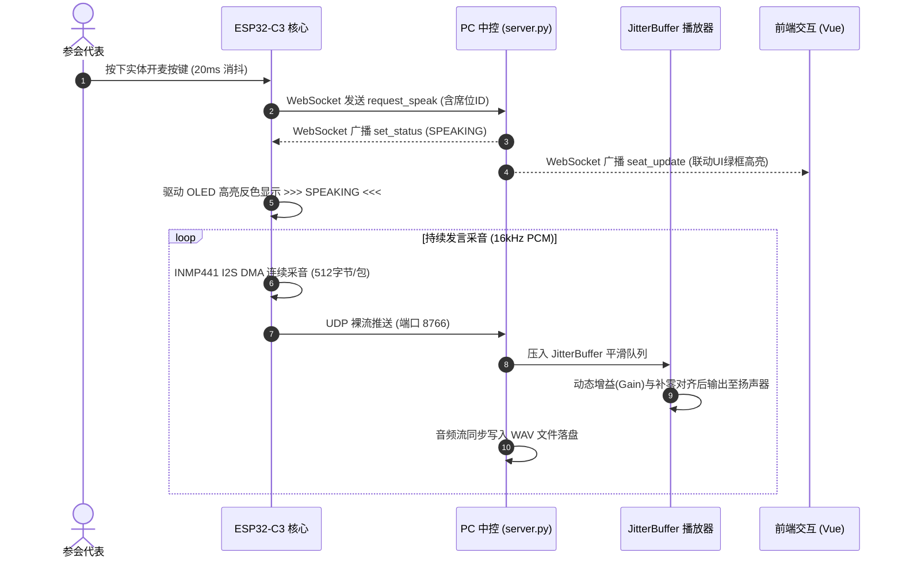
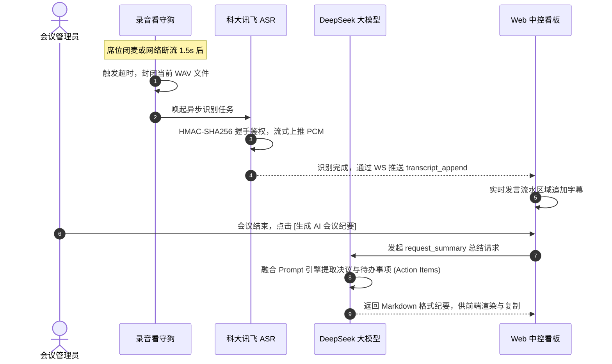

# 智慧音视频会议集成控制与流媒体调度系统（全工程技术交底与实施白皮书）

---

## 0. 项目速览 (Executive Summary)
本项目是一套针对现代化指挥中心与政企多功能协同会议室研发的 **IoT 软硬一体化流媒体调度系统**。
系统依托 **ESP32-C3** 作为边缘采集终端，通过硬件 I2S 高保真采集音频并以 UDP 裸流推送；利用 **Python** 构建中央调度大脑，实现低延迟平滑混音扩音；结合 **HBuilderX (Vue3)** 构建跨端中控看板与沉浸式 HDMI 大屏；并深度整合 **科大讯飞 ASR** 与 **DeepSeek 大模型**，实现了从“物理发言”到“语音实时上屏”，再到“一键生成结构化会议纪要”的全链路 AI 闭环。

**核心技术栈 (Tech Stack):**
* **底层硬件**: ESP32-C3 (RISC-V), FreeRTOS, INMP441 (I2S DMA), SSD1306 OLED (I2C)
* **后端中枢**: Python 3.10+, WebSocket, UDP Socket, PyAudio/SoundDevice (Jitter Buffer)
* **前端交互**: Vue3, Uni-app, HBuilderX, HTML5 Video 沉浸式渲染
* **AI 与算法**: HMAC-SHA256 鉴权, 科大讯飞流式语音识别 API, DeepSeek (LLM) Prompt 工程

---

## 1. 全局架构与通信拓扑

```mermaid
graph TB
    subgraph PC_Core["🖥️ PC 核心调度中枢 (Python 3.10+)"]
        direction TB
        WS_Bus["🌐 异步 WS 信令总线<br/>(TCP 端口: 8765)"]
        Jitter_Buf["🔊 Jitter Buffer 平滑播放器<br/>(UDP 端口: 8766)"]
        Wav_Rec["💾 标准 WAV 录音落盘<br/>(16kHz/16bit 单声道)"]
        Watchdog["🐕 音频静默看守狗<br/>(1.5s 超时自动封包)"]
        AI_Engine["🤖 AI 语音与纪要引擎<br/>(科大讯飞 ASR + DeepSeek)"]
        Cam_Stream["📷 OpenCV 720P 视频推流<br/>(HTTP 8080 / MJPEG)"]
    end

    subgraph MCU_Cluster["🎛️ 嵌入式终端集群 (ESP32-C3)"]
        direction TB
        INMP441["🎙️ INMP441 数字麦克风<br/>(I2S 硬件采集)"]
        ESP32["⚙️ ESP32-C3 SuperMini<br/>(FreeRTOS 双通道)"]
        OLED["🖥️ SSD1306 OLED 屏<br/>(I2C 状态渲染)"]
        KEY["🔘 物理轻触按键<br/>(20ms 软件消抖)"]
    end

    subgraph Frontend_App["💻 前端可视化交互系统 (Uni-app / Vue3)"]
        direction TB
        Control_Vue["🎛️ control.vue 调度中控台<br/>• 席位管控/调音/纪要生成"]
        Display_Vue["🖥️ display.vue 沉浸大屏<br/>• 满屏监控/特写/波形联动"]
    end

    %% 硬件内部连线
    INMP441 -->|I2S DMA 裸流| ESP32
    KEY -->|GPIO 中断| ESP32
    ESP32 -->|I2C 数据| OLED

    %% 网络传输链路
    ESP32 <==>|WebSocket 双向信令 (TCP 8765)| WS_Bus
    ESP32 -->|UDP PCM 音频推流 (UDP 8766)| Jitter_Buf
    ESP32 -->|UDP PCM 音频推流 (UDP 8766)| Wav_Rec

    %% PC 内部链路
    Wav_Rec -.->|断流监测| Watchdog
    Watchdog -.->|触发转写| AI_Engine
    Cam_Stream -->|HTTP MJPEG| Frontend_App

    %% 前后端交互
    WS_Bus <==>|WebSocket 广播同步| Control_Vue
    WS_Bus <==>|WebSocket 广播同步| Display_Vue
    AI_Engine -->|实时转写/结构化纪要推送| WS_Bus
```

---

## 2. 硬件方案与引脚分配

### 2.1 硬件物料清单 (BOM)
| 硬件名称 | 接口协议 | 参数与规范 | 选型考量 |
| :--- | :--- | :--- | :--- |
| **ESP32-C3 SuperMini** | Wi-Fi / GPIO | RISC-V 160MHz，集成 Wi-Fi | 体积极小，具备原生 I2S 与 DMA，足以支撑 16kHz 连续音频采集。 |
| **INMP441 麦克风** | 数字 I2S | 60dB SNR，24-bit 精度 | 纯数字输出，杜绝传统模拟驻极体麦克风的底噪与电磁干扰。 |
| **0.96 寸 OLED** | 硬件 I2C | SSD1306，128×64 单色 | 实时呈现本机 IP、发言状态、网络心跳与音量反馈。 |
| **轻触微动按键** | GPIO | 4 脚立式带支架 | 提供物理防抖申请发言交互（Toggle 逻辑）。 |

### 2.2 接线图与引脚分配规范

> ⚠️ **电源安全警告**：INMP441 麦克风的 VDD 必须接 `3.3V`，严禁接 `5V`，否则将瞬间击穿芯片内部 LDO！

```text
                       ┌─────────────────────────┐
                       │   ESP32-C3 SuperMini    │
                       │                         │
 (INMP441 SD)   ───────│ GPIO 0              5V  │─────── (供电 VCC)
 (INMP441 WS)   ───────│ GPIO 1               G  │─────── (共地 GND)
 (INMP441 SCK)  ───────│ GPIO 2             3.3V │─────── (系统 3.3V 供电轨)
 (发言物理按键) ───────│ GPIO 3                4 │
 (备用扩展口)   ───────│ GPIO 4                3 │
                       │ GPIO 5                2 │
                       │ GPIO 6                1 │
                       │ GPIO 7                0 │
 (OLED SDA)     ───────│ GPIO 8 (SDA)         20 │
 (OLED SCL)     ───────│ GPIO 9 (SCL)         21 │
                       └─────────────────────────┘
```

---

## 3. 开发环境与工程部署指南

### 3.1 核心依赖与环境版本
* **嵌入式端**：VS Code + PlatformIO 插件 (依赖库：`U8g2`, `ArduinoJson`, `WebSockets`)
* **服务端**：Python 3.10+ (依赖库：`websockets`, `pyaudio`, `sounddevice`, `numpy`, `opencv-python`)
* **前端端**：HBuilderX 3.8+ (Vue3 模式运行)

### 3.2 快速运行步骤 (Step-by-Step)
1. **配置 API 密钥**：
   * 打开 `backend_server/xf_asr.py`，填入科大讯飞的 `APPID`, `APIKey`, `APISecret`。
   * 打开 `backend_server/llm_summary.py`，填入 DeepSeek 的 `API_KEY`。
2. **启动调度大脑**：在 PC 终端运行 `python backend_server/server.py`，确保防火墙放行 `8765` 和 `8766` 端口。
3. **烧录终端固件**：在 `config.h` 中修改 `WIFI_SSID` 和 `SERVER_IP`，分别将 `SEAT_ID` 设为 1 和 2 编译并烧录至两块 ESP32-C3。
4. **运行前端总控**：在 HBuilderX 中打开 `SmartMeeting_Web`，点击“运行到内置浏览器”，即可在 `control.vue` 中接管全场。

---

## 4. 核心业务流程与交互时序

### 4.1 发言采集与平滑扩音时序



### 4.2 智能转写与纪要生成时序



---

## 5. 核心模块代码实现与技术原理

### 5.1 嵌入式端 (`mcu_firmware/src/`)
* **网络与信令守护 (`net_manager.cpp`)**：
  基于 `WebSocketsClient` 封装状态机。每 5 秒发送一次心跳，携带当前音量与禁音状态。捕获 `set_status`、`set_lock` 等下行指令，立即触发回调刷新 OLED 屏幕并改变 I2S 工作态。
* **UDP 低延迟音频引擎 (`audio_manager.cpp`)**：
  I2S 配置为 Master 接收模式 (16000Hz, 16bit)。利用 DMA 环形缓冲区无阻塞读取。UDP 包格式定义为 `[1 字节席位 ID + 512 字节 PCM 载荷]`，极简包头保证了局域网内端到端 $<50\text{ms}$ 的超低延迟传输。

### 5.2 PC 调度中枢 (`backend_server/`)
* **Jitter Buffer 平滑防爆音引擎 (`server.py`)**：
  针对 UDP 传输固有的网络抖动，设计了深度为 50 帧的线程安全缓冲队列。播放回调严格锁定 256 采样点（512 字节），面对单片机分包长度微小偏差，采用动态裁剪与 `np.zeros` 补零策略，彻底杜绝了声卡 under-run 爆音。
* **流式语音转写鉴权 (`xf_asr.py`)**：
  完全脱离官方臃肿 SDK，利用 Python 标准库构建 RFC1123 规范的时间戳与 HMAC-SHA256 签名，建立 `wss://iat-api.xfyun.cn/v2/iat` 连接。过滤掉 44 字节 WAV 头后，以 8KB 步长高频推送 PCM 数据，实现毫秒级文字返回。
* **大模型 Prompt 提炼 (`llm_summary.py`)**：
  将零散的会议流水文本汇总，通过定制的 System Prompt（要求提取：核心议题、各方观点、决议事项、待办清单），利用 `deepseek-chat` 接口实现自然语言的结构化重塑。

### 5.3 前端可视化交互 (`SmartMeeting_Web/`)
* **双向管控中控台 (`control.vue`)**：
  全面接管后端 `seat_update` 信令，实现席位状态的实时响应。整合滑块组件实现 0~100% 音量调音，并独立封装了 AI 纪要生成的 Markdown 渲染与一键复制功能。
* **沉浸式无边框大屏 (`display.vue`)**：
  摒弃常规的栅格布局，采用 CSS `absolute` 铺满底层 `<video>` 或 `<image>` 标签。前端结合发言人状态，动态弹出居中毛玻璃焦点浮层（CSS `backdrop-filter`）与 36 柱跳动音频波形，支持侧边栏抽屉式收纳以保证 100% 视频可视面积。

---

## 6. 岗位技能对齐与实战攻坚经验

本项目高度契合**“音视频设备售前售中技术工程师”**岗位的技术画像，在开发中攻克了以下核心技术壁垒：

| 故障现象与痛点 | 根本原因分析 | 工程解决方案落地 | 对齐的岗位技能 |
| :--- | :--- | :--- | :--- |
| **单片机 WS 频繁 5 秒断连** | Python 服务端未开启 Ping-Pong 保活，导致单片机底层超时。 | 服务端强制配置 `ping_interval=20, ping_timeout=20`，构建全双工保活体系。 | 深刻理解 TCP/IP 协议栈与长连接心跳保活机制。 |
| **PC 主持人麦克风无声** | PC 声卡重采样输出的字节长度无法匹配播放引擎的 512 字节硬校验。 | 引入 `bytearray` 规整缓冲池，将非定长流重组为定长切包，严格对齐。 | 掌握数字音频采样率、帧长处理与混音架构引擎设计。 |
| **开麦瞬间录音文件闪退** | 录音看守狗在首个 UDP 包抵达前，因初值时间戳为 0 误判超时。 | 启动录音瞬间即刻赋予当前时间戳，并将静默超时阈值放宽至 1.5 秒。 | 具备多线程并发下的时序控制、竞态条件分析排障能力。 |
| **前端控制台按钮不可交互** | 早期单片机心跳中缺失 `online` 标识，导致 Vue 响应式禁用按钮。 | 规范化信令协议，服务端解析心跳后强制补全 `online: True` 并全网广播。 | 掌握软硬件全栈集成、JSON 接口协议制定与联调能力。 |

---

## 7. 系统演进与未来扩展规划

1. **WebRTC 3A 工业级音频算法融合**：计划在 Python 混音链路层前置 WebRTC 算法库，引入 AEC (回声消除) 与 ANS (非平稳噪声消除)，以应对复杂物理环境下的扬声器啸叫。
2. **多模式抢麦与优先级仲裁引擎**：在现有的互斥逻辑基础上，引入 FIFO（先入先出）队列与角色权重，实现“主席绝对打断”、“代表排队申请”、“全开放自由混音”三大场景的动态切换。
3. **闭环文档与云端分发**：支持将 DeepSeek 提炼的 Markdown 纪要结合后端 Pandoc 引擎直接转化为 PDF/Word 报告，推送到企业微信或钉钉群，实现真正的无纸化智慧办公交付。